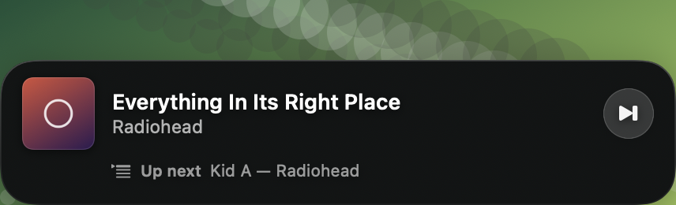
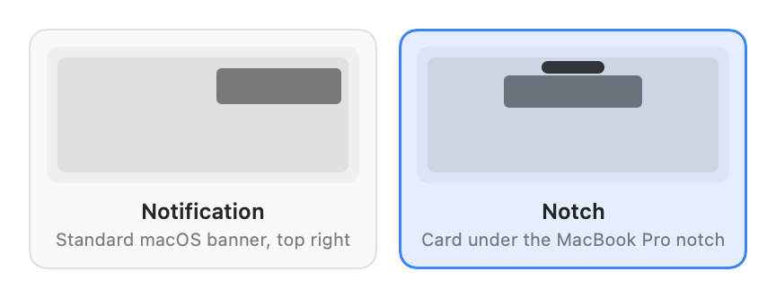
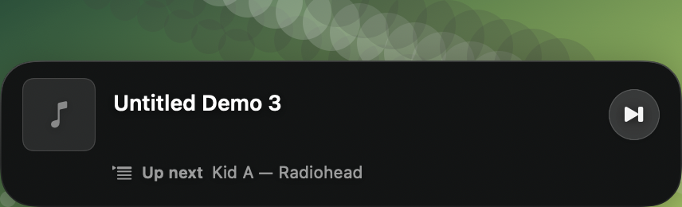

# Cuecard

**A card whenever a new song starts.** Cover, title, artist, a button to skip it — and a
one-liner telling you what plays next. Menu bar only: no Dock icon, no window.

[](https://github.com/rwijnen/cuecard/actions/workflows/ci.yml)
[](LICENSE)
[](#development)
[](#development)
[](Package.swift)
[](#ai-transparency)

```bash
git clone https://github.com/rwijnen/cuecard.git
cd cuecard && ./build.sh --install
```

Ten seconds, no Xcode needed — the Command Line Tools are enough. macOS 14+, Apple silicon
or Intel.

> **This app was vibecoded.** Effectively all of the code, tests and documentation were
> written by Claude Opus 5 in Claude Code. See [AI transparency](#ai-transparency) for what
> that means in practice and what has and has not been verified.

---



*Shown with Reduce Transparency on. Normally the card is Liquid Glass on macOS 26 and later,
and live vibrancy before that — both sample the desktop behind the card, which cannot be
captured offscreen.*

The menu bar icon's menu shows the same cover, with title, artist and album, whichever
style is chosen. Clicking it brings Spotify forward.

## Two places the card can appear



| | |
|---|---|
| **Notification** | A real macOS notification, top right. Obeys Do Not Disturb, stays in Notification Centre, carries the album art as an attachment and the skip as a notification action. **Requires a code-signing identity — see below.** |
| **Notch** | A card pinned under the MacBook Pro notch. Needs no permission, works in any build. Ignores Do Not Disturb and leaves nothing behind. |

### The notch card is not a notification

macOS exposes no API to put content in the notch. Anything that appears there is a
borderless window the app draws and positions itself, and Cuecard is no exception. It
measures the notch from `NSScreen.auxiliaryTopLeftArea` / `auxiliaryTopRightArea` rather
than assuming a size — a 14-inch M3 Pro reports 185 points, not the 200 usually assumed —
and centres the card on it. Clicks in the transparent strip above the card pass through, so
it never eats a click meant for the menu bar.

On macOS 26 and later the card, its skip button and the custom pieces of Settings are
Liquid Glass (`glassEffect`). Before that the card is real vibrancy (`NSVisualEffectView`,
`.behindWindow`). Either way a gentle scrim sits between the material and the text so white
text stays legible against a bright wallpaper — glass on its own comes out a flat mid-grey
over a white window, and a darker glass tint barely changes that — and an opaque fill
replaces both under Reduce Transparency. One non-obvious requirement for the vibrancy path:
the effect view's `state` must be `.active`, because the card lives in a non-activating
panel that is never key and the default `.followsWindowActiveState` would render it
permanently flat.

The glass code is guarded by `#if compiler(>=6.2)` as well as `#available(macOS 26, *)`,
so it still compiles — to the vibrancy look — with an SDK older than 26.

On a display without a notch — an external monitor — the card is anchored to `visibleFrame`
so it hangs below that display's menu bar rather than on top of it.

### Notifications need an Apple-issued certificate

macOS refuses notification authorisation to any app whose signature carries no **Team
Identifier**, and only an Apple-issued certificate provides one. Measured, not assumed:

| Signature | `TeamIdentifier` | `requestAuthorization` |
|---|---|---|
| Ad-hoc (`codesign -s -`) | not set | fails: *"Notifications are not allowed for this application"* |
| Self-signed certificate | not set | fails, identically |
| Apple Development / Developer ID | set | works |

One dead end worth naming so nobody else spends an afternoon on it: a **self-signed
code-signing certificate does not help.** Even created with the `codeSigning` EKU and
trusted for `codeSign`, `TeamIdentifier` stays unset, because macOS derives it from
certificate fields only Apple can issue.

**Getting a certificate is free.** It needs Xcode installed, but not a paid Developer
Program membership:

1. Xcode → Settings → Accounts → **+** → sign in with any Apple ID.
2. Select the account → **Manage Certificates…** → **+** → **Apple Development**.
3. Check it landed: `security find-identity -v -p codesigning` should list
   `Apple Development: you@example.com (XXXXXXXXXX)`.
4. Re-run `./build.sh --install`. It picks the identity up on its own and prints the Team
   Identifier it signed with — no code or config changes.

**If step 3 reports `0 valid identities found`** while the certificate clearly exists,
the chain is broken rather than the certificate. Check it:

```bash
security find-identity -p codesigning   # note: no -v, so invalid ones are listed too
```

`CSSMERR_TP_NOT_TRUSTED` there means the **Apple WWDR intermediate** that issued your
certificate is missing. Apple retired the original one in February 2023, and a machine that
has only that expired copy cannot build a chain for a modern `OU=G3` certificate. Xcode
ships the replacements, so no download is needed:

```bash
security add-certificates -k ~/Library/Keychains/login.keychain-db \
  /Applications/Xcode.app/Contents/SharedFrameworks/DVTFoundation.framework/Versions/A/Resources/AppleWWDRCA-2030.cer
```

Match the file to your certificate's issuer — `AppleWWDRCA-2030.cer` is `OU=G3`,
`AppleWWDRCAG6.cer` is `OU=G6`. Check yours with:

```bash
security find-certificate -c "Apple Development" -p | openssl x509 -noout -issuer
```

A paid membership ($99/yr) gets you a **Developer ID Application** certificate instead,
which `build.sh` also prefers automatically and which is what you would need to distribute
the app to anyone else.

Until then Cuecard does not go quiet: it notices the refusal, **falls back to the notch
card**, and says so in Settings with a one-click switch.

## The "Up next" line

This is the one feature that needs the network, and it is optional. Spotify's desktop app
tells the Mac what is playing *now* and nothing about what is queued — its scripting
interface has no concept of a queue. `GET /v1/me/player/queue` in the Web API is the only
source, so an "up next" line means signing in.

Setup is three steps, all in Settings (or the first-run wizard, where the whole step can be
skipped):

1. Create an app at [developer.spotify.com/dashboard](https://developer.spotify.com/dashboard).
2. Add `http://127.0.0.1:8888/callback` as a Redirect URI, exactly. Spotify requires the
   literal loopback address; it stopped accepting `localhost` in 2025.
3. Paste the Client ID and press Connect.

Sign-in is Authorization Code with **PKCE**, so no client secret is stored anywhere — a
desktop app cannot keep one. The only scope requested is `user-read-playback-state`;
skipping goes through the local app, which needs no scope and no Premium subscription. The
refresh token goes in the Keychain, with a `0600` file in Application Support as a fallback
if the Keychain refuses.

Without a connection everything else works — the card simply has no last line.



## How it detects a track change

Not by polling. Spotify broadcasts a distributed notification,
`com.spotify.client.PlaybackStateChanged`, on every playback change, and it carries the
whole track in its `userInfo`. That is the primary trigger: instant, free, and requiring
**no Automation permission at all**.

Apple Events are used for exactly two things the broadcast cannot do — fetch the artwork
URL, and skip — so the permission prompt only appears when you press something. A slow
5-second poll runs alongside as a safety net and to keep the playback position fresh, which
is what makes repeat-one detectable.

Between Spotify and your notification centre sits a filter, because Spotify also broadcasts
on pause, resume and seek, and the poller re-reports the same track every few seconds:

| Situation | Result |
|---|---|
| A different track starts | Announced |
| The same track re-reported | Silent |
| Paused, then resumed | Silent (opt in under Settings) |
| Repeat-one wraps around | Announced |
| Whatever was playing when the app launched | Silent — you know what is on |
| Position jitter near the start | Silent |

## Permissions

| | |
|---|---|
| Track detection | None |
| Album art, skipping | Automation, for Spotify — prompted once, on first use |
| Notification style | Notifications, plus a code-signing identity |
| Notch style | None |

Cuecard never plays anything on its own, never writes to your library, and talks to no
network host but `accounts.spotify.com`, `api.spotify.com`, Spotify's image CDN, and
GitHub for updates (`api.github.com`, plus GitHub's download host when you install one).

## Updates

Once a day Cuecard asks GitHub for the latest
[release](https://github.com/rwijnen/cuecard/releases). If it is newer, it says so and
offers **Install and Relaunch**, **Later** or **Skip This Version**. Settings → Updates has
the switch for the daily check and a **Check Now** button; the menu has **Check for
Updates…**, which becomes **Update to Cuecard X…** once one is found.

Installing downloads the release's `Cuecard.zip` and replaces the running app only if every
check passes, in this order — any failure leaves the installed copy untouched and offers
the release page instead:

1. The running copy carries a Team Identifier. An ad-hoc build has none, so there is
   nothing to compare a download against, and it is never replaced automatically.
2. The download's signature is intact and chains to an Apple-issued certificate of **the
   same team** (`anchor apple generic and certificate leaf[subject.OU] = "<team>"`) with
   the same bundle identifier. HTTPS proves the file came from GitHub; this proves it was
   built by whoever holds your certificate.
3. The bundle's version is the one the release announced.

The swap itself is one `FileManager.replaceItemAt` on the same volume, then a detached
shell waits for the old process to exit and opens the new one.

### Publishing a release

Push a tag and the [release workflow](.github/workflows/release.yml) builds a universal
app, stamps the tag's version into it, signs it, and publishes `Cuecard.zip`:

```bash
git tag v1.1.0 && git push origin v1.1.0
```

It needs two repository secrets: `SIGNING_CERTIFICATE_P12` (base64 of a `.p12` export of
your Apple Development or Developer ID Application certificate with its private key) and
`SIGNING_CERTIFICATE_PASSWORD`. Use a certificate from the same team as your local builds,
or the updater will rightly refuse the result. The workflow fails rather than publish an
unsigned build, since every installed copy would reject it.

The archive is not notarized. That does not matter to the in-app updater, which downloads
without the quarantine flag, but someone downloading `Cuecard.zip` in a browser will meet
Gatekeeper.

## Development

```bash
swift test          # 82 tests, no network, no Spotify needed
swift build
./build.sh          # build/Cuecard.app
./build.sh --debug
./build.sh --universal --version 1.2.0   # what the release workflow runs
```

The parts worth knowing about are separated so they can be tested as pure functions:
`TrackChangeDetector` (the announce/stay-quiet rules), `NotchGeometry` (where the card
goes, including the real measurements from a 14-inch M3 Pro whose primary display is an
external monitor, so the built-in panel has a negative frame origin), `SpotifyEvents`
(broadcast payload parsing), `SpotifyScripting.parseSnapshot`, `SpotifyWebAPI.decodeQueue`,
and `AppVersion` / `GitHubRelease` (version ordering and release parsing for the updater).

`swift run Cuecard` works for iterating on the notch card, and falls back to it
automatically: several system frameworks — `SMAppService`, `UNUserNotificationCenter` —
raise an Objective-C exception that Swift cannot catch when called from a process that is
not a real `.app`, so `AppBundle.isApp` is checked before any of them. Anything touching
notifications or the login item needs `./build.sh --install`.

Two things that bit during development and are now pinned by tests:

- **`st` is a reserved word in AppleScript** — the ordinal suffix from "1st". `set st to …`
  is a syntax error, so the scripts spell their variables out.
- **AppleScript formats reals with the user's decimal separator.** On this machine
  `player position` comes back as `248,675`, and parsing it as `Double` without
  normalising the comma silently broke repeat-one detection.

Logging goes through one subsystem:

```bash
log stream --predicate 'subsystem == "com.robinwijnen.Cuecard"'
```

## AI transparency

Cuecard was vibecoded. Every Swift file, every test, the icon generator, the build script
and this README were written by **Claude Opus 5** running in
[Claude Code](https://claude.com/claude-code), from prompts. There is no meaningful hand-written
code in this repository.

The human contribution was direction and judgement: deciding what the app should be, choosing
between the approaches offered, rejecting the ones that were wrong, running it on real
hardware, and saying when the result looked wrong. Several of the design decisions documented
above — the presentation styles, keeping the Web API optional, the first-run flow — came from
that side of the conversation, not from the model.

**What has been verified**

- 82 automated tests, run in CI on every push. They are hermetic: no network, and Spotify
  need not be installed.
- The whole pipeline exercised against a real Spotify client on a 14-inch MacBook Pro (M3
  Pro): real track-change broadcasts detected, real skips issued, notifications delivered,
  the notch card's window frame checked against the geometry it was supposed to produce.
- Notifications confirmed working end to end, including the album-art attachment and the
  up-next line.

**What has not**

- One machine, one macOS version (26.5), one Spotify version. Nothing here has been tested
  across a range of hardware, display arrangements or locales — though the locale-dependent
  AppleScript bug above was found and fixed precisely because that assumption broke once.
- No external code review or security audit.
- The updater has not yet installed a real release end to end, because none had been
  published when it was written. Its signature check was exercised against real bundles —
  accepting a genuine one after a `ditto` round trip, rejecting a wrong team, a tampered
  file and an ad-hoc re-sign — but the download-swap-relaunch sequence has only been
  reasoned about.
- Parts of the visual result were checked by a human eye rather than by the model: this
  machine grants no Screen Recording permission, so the model could verify window geometry
  numerically but could not see what it had drawn. Where it guessed at appearance it was
  sometimes wrong, and was corrected by screenshots from the human side.

Treat it as what it is: a small, well-tested personal tool that reads your Spotify state and
draws a card, published in case it is useful. Read the source before you trust it — about
3,200 lines under `Sources`, plus 850 of tests, deliberately commented to explain *why*
rather than what.
